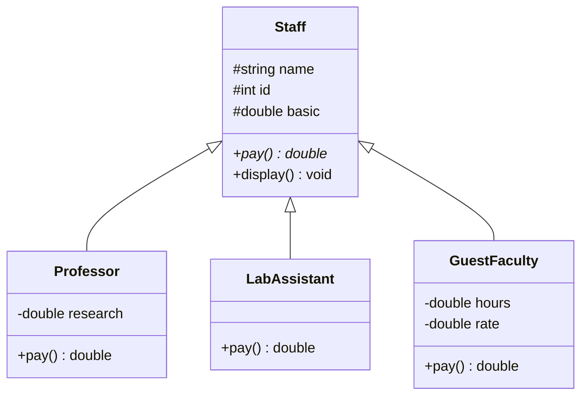
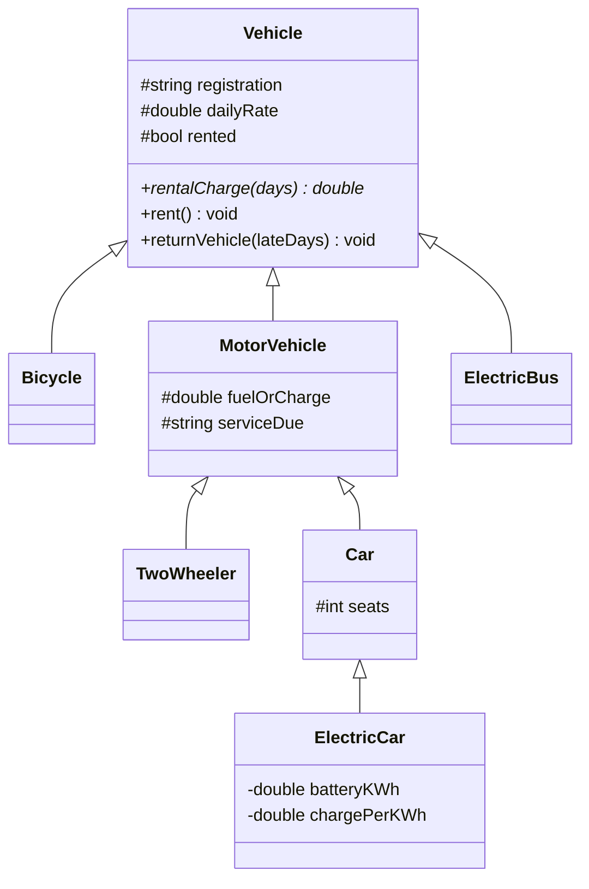

# Assignment 4 – Designing Reusable Class Hierarchies

**Student name:** ENTER YOUR NAME  
**Register number:** 192472066  
**Course:** Object Oriented Programming with C++ (DSA01)  
**GitHub repository:** PASTE YOUR REPOSITORY URL HERE

> Complete this report with your own execution observations, screenshots and measurements. Predictions must be recorded before running the corresponding programs.

## Task 1 – Class Design Review

### 1.1 Design deficiencies
1. `name`, `id` and `basic` are repeated in multiple classes.
2. Data members are public, so callers can change object state without validation.
3. `GuestFaculty` uses `nm` and `code` instead of consistent names.
4. `da` is declared but never used.
5. The value `0.42` is a magic number repeated in pay calculations.
6. A new staff category requires another independent class and changes to code that processes staff.
7. The unrelated classes cannot be processed uniformly through a common staff interface.

### 1.2 Repaired hierarchy



`Staff` is abstract because `pay()` is pure virtual. Each derived class provides its own pay rule. A collection of base-class pointers can process every staff type using runtime polymorphism.

### 1.3 Design defence (under 100 words)
The common identity and interface are placed in `Staff`, while each derived class stores only the data specific to its pay calculation. A new category can derive from `Staff` and implement `pay()` without rewriting the existing staff classes or the loop that processes employees. This reduces duplication and supports extension through polymorphism.

### Alternative: one class and a type switch
A single class would need a type code and fields for all possible staff categories. `pay()` would use a switch. Both designs take O(1) time per pay calculation. The single class can waste space because each object reserves fields it may not use. Adding a category requires changing the type definition, switch, and possibly input/output code; the polymorphic design normally adds a derived class.

## Task 2 – From Requirement to Hierarchy

### 2.1 Relationships
- `Student` is-a `Person`: public, single inheritance.
- `Staff` is-a `Person`: public, single inheritance.
- `TeachingAssistant` is-a `Student` and is-a `Staff`: public multiple inheritance.
- `ResearchScholar` is-a `Student`: public multilevel inheritance.
- `Person` is a shared virtual base of `Student` and `Staff`; the combined design is hybrid inheritance.
- A `Person` may have an `Address` member: has-a/composition, if address details are included.

### 2.2 Diamond problem
Without virtual inheritance, `TeachingAssistant` contains one `Person` subobject through `Student` and another through `Staff`. Accessing a common `Person` member can become ambiguous. Declaring both intermediate base classes as `virtual public Person` makes the most-derived `TeachingAssistant` contain one shared `Person` subobject. The most-derived constructor initializes that virtual base.

### 2.3 Class design
The implementation is in `Task02/main.cpp`. `Person` is inherited publicly and virtually by `Student` and `Staff`. `TeachingAssistant` inherits publicly from both. `ResearchScholar` inherits publicly from `Student`.

### 2.4 Access table

| Member declared in Person | Student : public Person | Student : protected Person | Student : private Person |
|---|---|---|---|
| public | public | protected | private |
| protected | protected | protected | private |
| private | not directly accessible | not directly accessible | not directly accessible |

### Composition alternative
If `TeachingAssistant` contains separate `Student` and `Staff` members, it has-a relationship rather than is-a. The contained objects each contain their own `Person` portion, so there can be two `Person` subobjects. Access goes through the member names, such as `student.name` (subject to access control), rather than being inherited directly. Use `sizeof` on the actual classes to record compiler-specific object sizes; virtual inheritance and implementation details can affect the result.

## Task 3 – Constructors and Member Classes

### 3.1 Initializer lists
A derived constructor passes base values in its initializer list, for example `Student(...) : Person(name, age)`. With virtual inheritance, the most-derived class is responsible for initializing the virtual base. An intermediate class's virtual-base initializer is ignored when that intermediate class is not the most-derived object.

### 3.2 Member classes
The implementation in `Task03/main.cpp` gives `Person` an `Address` member and `Student` a `Course` member. Their constructors receive values in the enclosing class's initializer list.

### 3.3 Construction/destruction rule
Construction: virtual bases, direct bases in declaration order, data members in declaration order, then the constructor body. Destruction occurs in reverse order.

### 3.4 Experiment
Compile the supplied virtual-inheritance example both with and without `virtual`. Record the exact output and `sizeof(TeachingAssistant)` from your compiler. Do not assume the size is identical across compilers or platforms.

## Task 4 – Pointers to Derived Classes

### 4.1 Defects
- `rate()` is non-virtual, so `Account*` calls `Account::rate()`.
- Deleting a derived object through a base pointer when the base destructor is non-virtual is undefined behaviour; the derived cleanup may not run.
- Copying a `SeniorAccount` into an `Account` object causes object slicing: only the base subobject is copied.

### 4.2 Evidence
The original PDF snippet should be compiled separately with AddressSanitizer where supported. Add destructor messages and save the actual sanitizer report. The repaired demonstration in `Task04/main.cpp` uses a virtual destructor and smart pointers; it is not a substitute for capturing evidence from the original defective example.

### 4.3 Repair and prevention
Make the polymorphic operation virtual and mark overrides with `override`. Give a polymorphic base class a virtual destructor. Store owning polymorphic objects using `std::unique_ptr<Account>` in a vector instead of manually managed raw pointers. Use pointers/references when polymorphic identity must be preserved instead of copying a derived object into a base object.

### Alternative: vector of unique pointers
Processing n accounts remains O(n); each virtual call is O(1). Each vector element stores a smart pointer, and each object is separately allocated. RAII prevents the manual-delete leak and the virtual destructor ensures correct cleanup. Slicing is avoided when objects are kept behind base pointers. Incorrect virtual declarations can still cause dispatch mistakes.

## Task 5 – Pointers to Objects and this

### 5.1 Four ways
- Direct object: `Cart c; c.total();`
- Pointer to existing object: `Cart* p = &c; p->total();`
- Reference: `Cart& r = c; r.total();`
- Dynamic object: `Cart* q = new Cart; ... delete q;` (prefer smart pointers in production code).

### 5.2 Highest total
For an array of `Cart*`, initialize the current maximum from the first valid cart, then scan the remaining pointers and compare `total()`. This is O(n) time and O(1) extra space.

### 5.3 this pointer
`this` points to the current object inside a non-static member function. `*this` is the current object itself. Returning `Cart&` allows chained calls without copying the object. `this->discount` explicitly refers to the data member when a parameter has the same name.

### Alternative: vector of objects
Finding the maximum remains O(n). A vector of objects stores the objects directly, while a vector of pointers stores pointer values and separately allocated objects (if dynamically allocated). When a vector grows and reallocates, pointers/references/iterators to its elements may be invalidated. A vector of `unique_ptr<Cart>` keeps the pointed-to Cart objects stable across vector reallocation, although iterators to vector elements can still be invalidated.

## Task 6 – Vehicle Rental Fleet

### 6.1 Entities and testable requirements
- Every vehicle has a registration number, daily rate and rental state.
- Bicycles, two-wheelers, cars and electric cars must be represented.
- Motor vehicles store a fuel/charge level and service due date.
- Cars store seating capacity.
- Electric cars store battery capacity and a per-kWh charge rate.
- Each type calculates its charge through its own implementation.
- The system can rent, return, list and calculate charges.
- A new vehicle type can be added without modifying existing vehicle classes.

### 6.2 Proposed hierarchy



### 6.3 Critical decisions
`Vehicle` is abstract and exposes a pure virtual `rentalCharge()`. Derived classes override it. The fleet is stored as `std::vector<std::unique_ptr<Vehicle>>`, enabling polymorphism and automatic cleanup. Shared rental state and common operations belong in `Vehicle`; type-specific data belongs in the relevant derived class.

### 6.4 Renting/returning pseudocode
```text
PROCEDURE RentVehicle(vehicle)
    IF vehicle is already rented
        DISPLAY "Already rented"
    ELSE
        SET rented to true
        DISPLAY confirmation
    END IF
END PROCEDURE

PROCEDURE ReturnVehicle(vehicle, lateDays)
    IF vehicle is not rented
        DISPLAY "Not rented"
    ELSE
        SET rented to false
        lateCharge <- lateDays * dailyRate * lateChargeRate
        DISPLAY return confirmation and lateCharge
    END IF
END PROCEDURE
```

### 6.5 Implementation
See `Task06/main.cpp`. It demonstrates bicycles, two-wheelers, cars, electric cars and an additional `ElectricBus` class. The sample late-charge rule is illustrative; replace it if your faculty specifies a different policy.

### Alternative: one class with a type switch
A single `Vehicle` class would need fields for every vehicle type and a switch inside `charge()`. Both a switch and a virtual call are O(1) per charge calculation. The single class may reserve unused fields for every object. Adding a new type changes the switch and likely the shared class; the abstract-base design adds a new derived class.

## Final execution and evidence checklist

For each task, attach:
- source code;
- exact compile command;
- actual output;
- terminal screenshot;
- prediction and explanation where requested.

For Task 4, include the genuine AddressSanitizer output for the original defective example and the corrected implementation. Add your GitHub URL to this report and the cover page.
