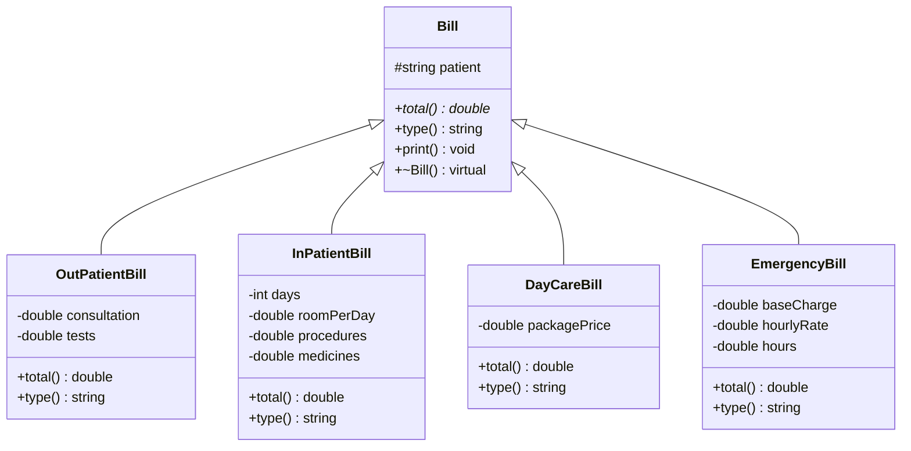

# A1 – Design the Polymorphic Bill Hierarchy

## A1.1 Common interface and shared data
All bills need a patient identifier/name and should provide:
- `total() const`: calculate the bill amount;
- `type() const`: identify the bill category;
- `print() const`: display the category, patient and total.

The abstract `Bill` base class stores common patient information. `total()` is pure virtual; `type()` is virtual and can provide a default label; `print()` uses the common interface.

## A1.2 UML



`total()` is pure virtual in `Bill` and overridden by every concrete bill type. `type()` is virtual and overridden. `print()` is an ordinary non-virtual member that calls the virtual functions.

## A1.3 Pseudocode – total all bills

```text
ALGORITHM CalculateDailyTotal
INPUT: bills, an array of pointers to Bill; count
totalForDay <- 0
FOR index <- 0 TO count - 1
    IF bills[index] IS NOT NULL THEN
        totalForDay <- totalForDay + bills[index].total()
    END IF
END FOR
OUTPUT totalForDay
END ALGORITHM
```

## Alternative: one structure with a type and switch
A single structure stores a category code and fields for all bill variants. `total()` uses a switch to choose the formula. Both designs process n bills in O(n) time and perform O(1) work per bill. A switch structure can waste space because each object reserves fields that do not apply to its type. Adding a bill type requires changing the structure, switch and related code. A polymorphic design adds a derived class implementing the interface.
