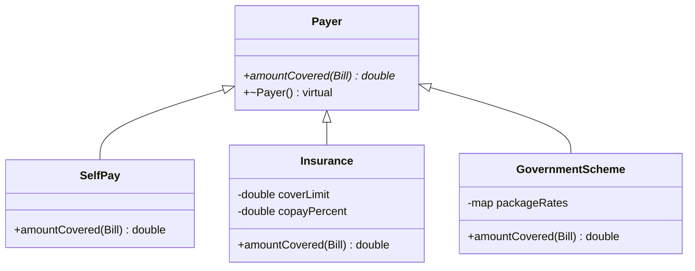

# A3 – Abstract Payer Design

`Payer` is abstract because `amountCovered(const Bill&)` is pure virtual. `SelfPay` may cover the full bill; `Insurance` applies the policy limit and co-payment rule; `GovernmentScheme` uses a configured fixed package amount.

## Extension
A corporate payer can derive from `Payer` and implement `amountCovered()` using corporate coverage rules. Existing payer classes and code that processes `Payer` references need not change.

## Alternative: function object
A policy can be represented by a function pointer or `std::function<double(const Bill&)>`, with policy data captured by a callable object. Each invocation is O(1) for a simple rule in either design. An abstract class naturally groups policy data and behaviour; a callable can be lightweight but may need a separate state object or captured values.
